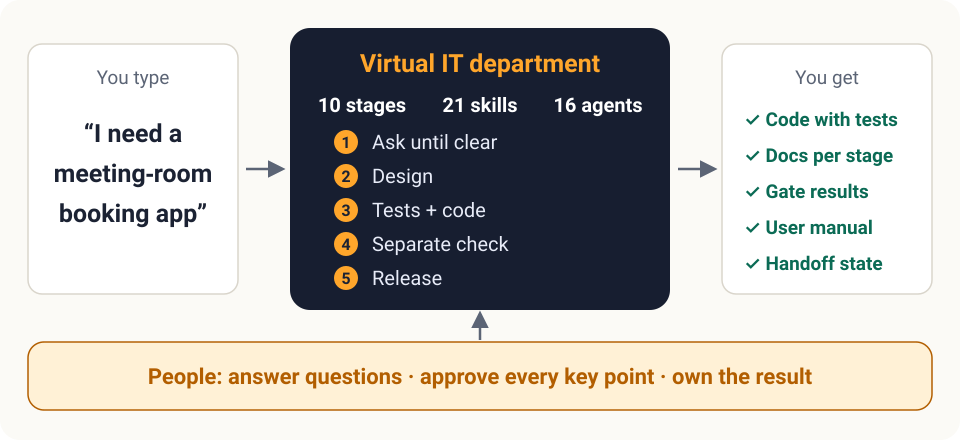
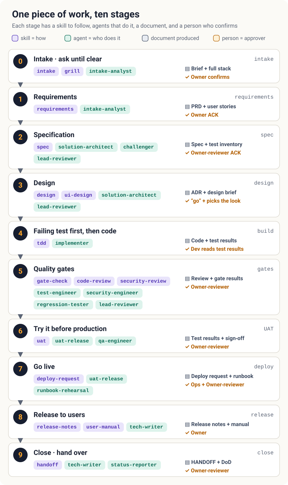
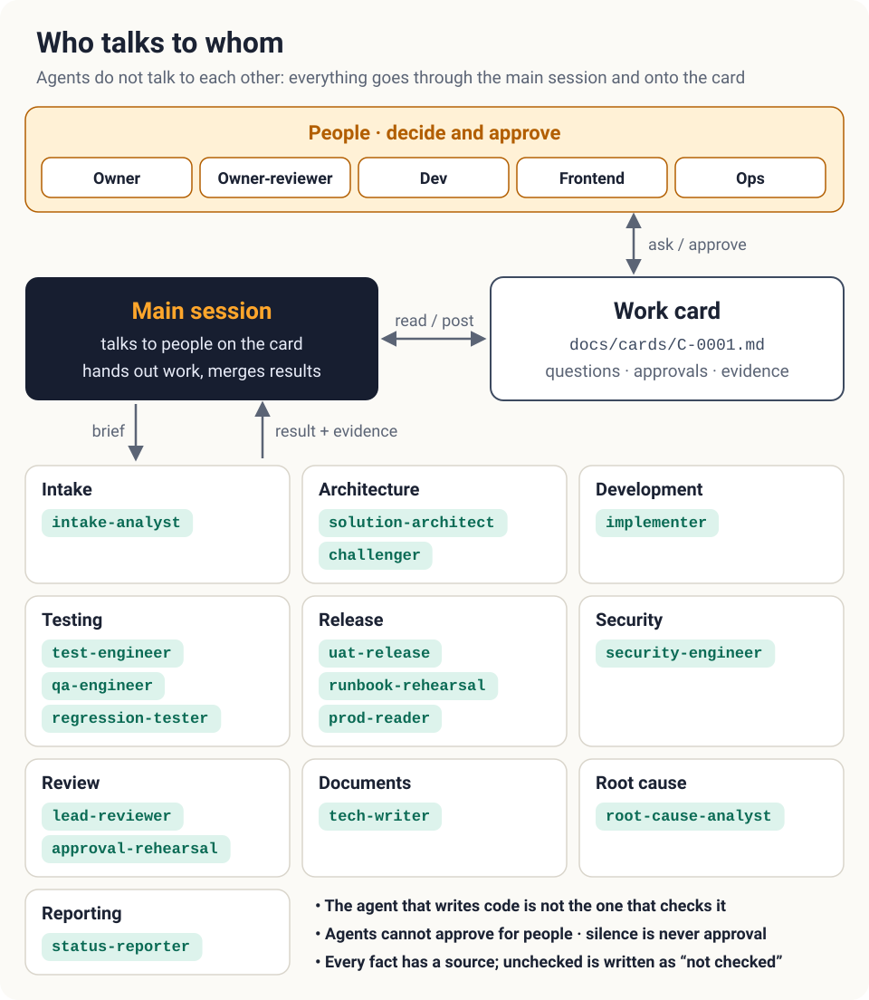
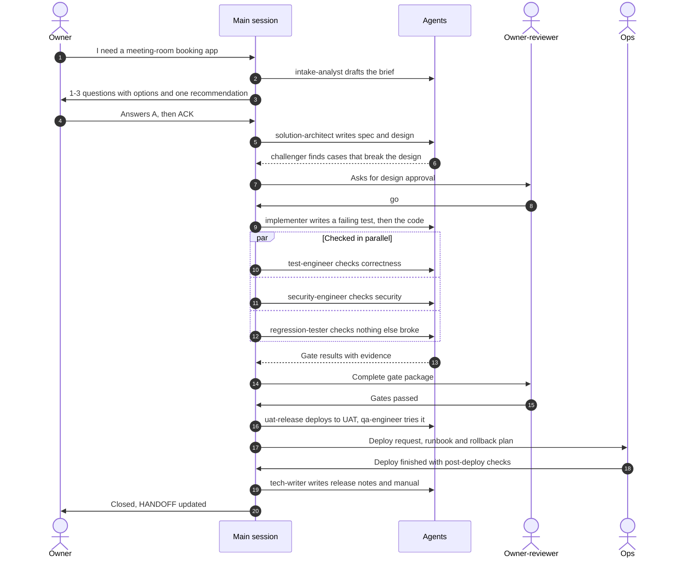
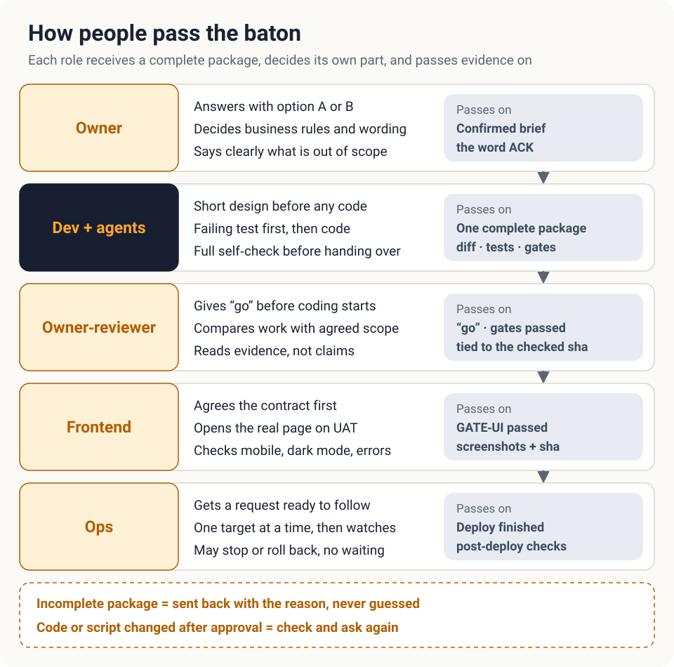
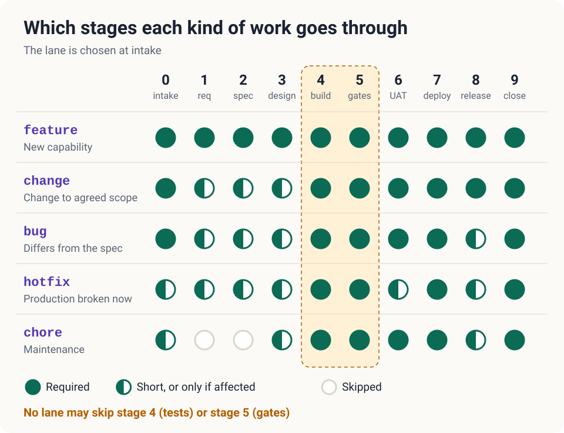
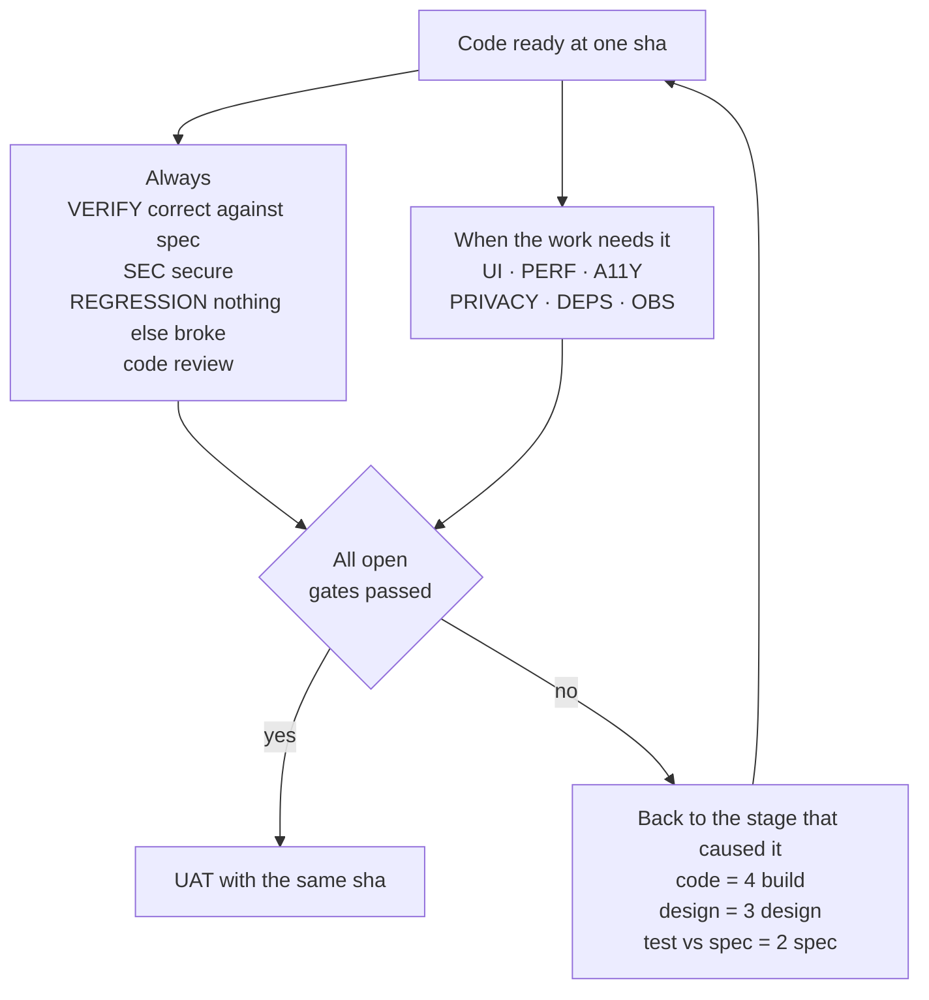

# engineering-blueprint

[ไทย](README.md) · **English**

**A starter repo that makes AI coding agents work like a small IT department instead of answering one prompt at a time.**
Clone it, run one command, and get a project folder with rules, a workflow, document templates and agent roles ready to use.



> Status: v0.4.0. The principles come from experience of working as a team. One full cycle has been run on a local trial ([results](#trial-run)); it has not been used on a system with real users. The files in `docs/`, the skills and the templates are written in Thai; agents can still read and follow them, and reply in your language.

**Contents:** [Why](#why) · [How work flows](#how-one-piece-of-work-flows) · [How agents work together](#how-agents-work-together) · [Team principles](#team-principles) · [Worked example](#worked-example-meeting-room-booking) · [21 skills](#21-skills) · [16 agents](#16-agents) · [5 lanes](#five-lanes) · [Gates](#quality-gates) · [Trial run](#trial-run) · [Start](#start)

## Why
AI writes code fast. Real work usually breaks on everything around the code:

| Problem | What this repo does |
|---|---|
| A one-line request makes the AI guess | Skill `intake` asks until both sides agree, before any work |
| A new chat forgets everything | State lives in `docs/HANDOFF.md`, memory in `memory/`, not in the chat |
| Code looks finished but has no tests | Tests are written from the spec first; a different agent checks |
| A token or password reaches git | A hook scans before every commit |
| No documents, nobody can take over | Templates from requirement to user manual |
| Nobody knows who approved what | People approve on the card, with role and date |

Four words to know:
- **Card**: one piece of work. It holds questions, answers, approvals and evidence (a file in the repo by default).
- **Skill**: a step-by-step way of working, like a procedure manual.
- **Agent**: a role that follows skills, such as designer, writer or checker.
- **Gate**: a check that must pass before moving on.

## How one piece of work flows



`planning` orders the backlog before stage 0; `retro` improves the way of working after stage 9. Full version: [`docs/workflow.md`](docs/workflow.md) (Thai).

## How agents work together



1. **People talk to one main session.** You do not need to know which agent does what, only what you must approve.
2. **The main session hands out briefs**: which files to read, which files may be written, what done means, what is forbidden.
3. **Agents return results with evidence**, such as `src/booking.ts:42@a1b2c3d` or `npm test → "12 passed"`.
4. **Work that touches different files runs in parallel.** One file has one writer at a time.

Tools that can start sub-agents run the roles separately. In a tool that cannot, one session reads each role file and plays the roles in turn, which is a weaker separation.

The conversation for one piece of work:



## Team principles
These come from how people in different roles work together, rewritten to be neutral so any team can use them.



| Principle | Without it | How it works here |
|---|---|---|
| **Agree the design before code** | Finished work gets torn down | 5–8 line design brief → review → "go" → code ([`design`](.claude/skills/design/SKILL.md)) |
| **Ask so it can be answered in one round** | Days of back and forth | Question, options, one recommendation, what it blocks ([`docs/posting.md`](docs/posting.md)) |
| **Every fact has a source** | Arguments from memory | `file:line@sha`, or command + result line; unchecked is written as "not checked" |
| **Check fully before handing over** | The next person waits, then sends it back | Dev runs the checklist; an agent rehearses the approver's questions ([`docs/roles/dev.md`](docs/roles/dev.md)) |
| **Approval is tied to a version** | One thing approved, another deployed | Approval names the sha; a change means check and ask again |
| **Silence is not approval** | Work moves with no decision | No answer means not decided; do the unblocked parts meanwhile |
| **Ops gets something ready to follow** | The person deploying has to guess | Line-by-line runbook, expected results, stop points, rollback ([`docs/deploy.md`](docs/deploy.md)) |
| **Reviewed scripts instead of manual clicks** | Mistakes that cannot be repeated or traced | Tested scripts with dry-run; approval bound to the file's hash ([`docs/db-scripts.md`](docs/db-scripts.md)) |
| **Agree the contract before the screen** | Front end and back end do not match | One schema as the source, tested on both sides ([`docs/roles/frontend.md`](docs/roles/frontend.md)) |
| **Done means it works for users** | "Done", yet nobody can use it | Definition of Done covers UAT, the real page, post-deploy watch and docs |
| **Gates never shrink; go faster in parallel** | Rushed checks break production | Gates run side by side; a refusal means stop and ask, never a detour |
| **Anyone can take over** | Work is stuck with one person | `docs/HANDOFF.md` says where it stands, who waits for what, what is next |

## Worked example: meeting-room booking
An illustration of what you type and what comes back.

| Stage | You do | Behind the scenes | File |
|---|---|---|---|
| 0 intake | Type "I need a meeting-room booking app", answer questions | `intake-analyst` reads the repo first, asks 1–3 at a time, picks lane and risk | `docs/requirements/0001-room-booking.md` |
| 1 requirements | Read and reply ACK | Split into user stories with Given/When/Then | PRD + stories |
| 2 spec | Owner-reviewer replies ACK | `solution-architect` writes; `challenger` looks for failures, e.g. two people booking at once | `docs/specs/0001-room-booking.md` |
| 3 design | Owner-reviewer replies "go" | At least two options compared, reason recorded | ADR + design brief |
| 4 build | Wait | `implementer` writes "double booking is rejected" as a failing test, then the code | Code + tests |
| 5 gates | Owner-reviewer reads results | Four agents check separately: correctness, security, regression, code review | Gate results on the card |
| 6 UAT | Frontend tries the real page | `uat-release` deploys to UAT; `qa-engineer` tests against the criteria | Test results + sign-off |
| 7 deploy | Ops approves and deploys | `runbook-rehearsal` walks the runbook on paper first | Deploy request + runbook |
| 8 release | Owner reads the user-facing text | `tech-writer` writes it | Release notes + web manual |
| 9 close | Owner-reviewer closes | Definition of Done checked | `docs/HANDOFF.md` |

What a card looks like (layout from a real run of the commands; text translated from Thai):

```markdown
# C-0001 · Meeting-room booking

- lane: feature
- R: R2
- status: intake
- created: 2026-11-22

---
### 2026-11-22T05:32:24.939Z · agent

Accepted C-0001 · stage 0 intake

Question 1/3: may two bookings overlap?
- A) No, the system refuses at once (recommended: two teams never collide)
- B) Yes, with an approver
Blocks: booking design

---
### 2026-11-22T05:32:25.075Z · owner

A) No
```

## 21 skills
Skills are markdown files in [`.claude/skills/`](.claude/skills/), so any tool can read them.

| Phase | Skill | Use it when |
|---|---|---|
| **Before** | `planning` | Ordering and sizing the backlog |
| | `intake` | A new request arrives; ask until clear |
| | `change-request` | Something already agreed must change |
| **Think** | `requirements` | Turning the brief into a PRD and user stories |
| | `spec` | Writing the spec, expected results and test inventory |
| | `design` | Comparing options, recording reasons, asking for "go" |
| **Build** | `tdd` | Test before code |
| | `bugfix` | Reproduce, find the cause, smallest fix |
| | `hotfix` | Production is broken now |
| | `db-script` | Reading or changing data safely |
| **Check** | `gate-check` | Running every gate of the work |
| | `code-review` | Reviewing code before merge |
| | `security-review` | Checking against OWASP ASVS and Top 10 |
| | `uat` | Deploying to UAT and testing real use |
| **Deliver** | `deploy-request` | A request Ops can follow at once |
| | `release-notes` | CHANGELOG and version number |
| | `user-manual` | Web user manual |
| **Talk and learn** | `post` | Card posts that can be answered in one round |
| | `handoff` | Saving state for the next person |
| | `postmortem` | Blameless review of an incident |
| | `retro` | Reviewing the cycle and improving the way of working |

## 16 agents
Role files are in [`.claude/agents/`](.claude/agents/). The model tier follows the difficulty of the job. None of them can approve for a person.

| Team | Agent | Does | Model tier | Has file-writing tools |
|---|---|---|---|---|
| Intake | `intake-analyst` | Turns a request into a brief; proposes lane and risk | Small | – |
| Architecture | `solution-architect` | Spec, options, ADR | Strongest | ✓ docs |
| | `challenger` | Finds cases that break the design | Strongest | – |
| Development | `implementer` | Test first, then code | Mid | ✓ code |
| Testing | `test-engineer` | Writes tests from the spec, apart from the code author | Mid | ✓ tests |
| | `qa-engineer` | Tries it on UAT: UI, speed, accessibility | Mid | – |
| | `regression-tester` | Does everything else still work; can we roll back | Strongest | – |
| Security | `security-engineer` | OWASP, personal data, dependencies | Strongest | – |
| Release | `uat-release` | Deploys to UAT, prepares the request, never touches production | Mid | – |
| | `runbook-rehearsal` | Walks the runbook on paper | Strongest | – |
| | `prod-reader` | Runs only approved read-only scripts | Small | – |
| Documents | `tech-writer` | HANDOFF, CHANGELOG, manual | Small | ✓ docs |
| Review | `lead-reviewer` | Reviews code against scope | Strongest | – |
| | `approval-rehearsal` | Rehearses the approver's questions | Strongest | – |
| Root cause | `root-cause-analyst` | Finds causes from evidence; does not change code | Mid | – |
| Reporting | `status-reporter` | Status that people outside the team understand | Small | ✓ reports |

"–" means no Write/Edit tool is granted. Roles with Bash could still write files technically, so that part is an instruction, not a hard barrier.

## Five lanes



Risk raises the depth; it never removes a gate:

| | R1 low | R2 medium | R3 high |
|---|---|---|---|
| Example | Text, style, docs | An ordinary new feature | Permissions, personal data, irreversible data |
| Stages 1–3 | May be skipped, brief is enough | Spec and design required | All required |
| Security | Basic checklist | ASVS L1 | ASVS L2 |
| Review | 1 AI | AI + 1 person | AI + a person who is not the author |
| Deploy | Normal | One target at a time + watch | + kill switch + rehearsed rollback |

### How often people approve
Every gate still runs; what changes is how often the work waits for a person ([`docs/workflow.md`](docs/workflow.md), Thai). The ten-stage picture above is the full R3 form.

| | R1 | R2 | R3 |
|---|---|---|---|
| Before code | Not asked, if the Owner approved it for the whole project in advance | One "go" | ACK brief, ACK scope, "go" |
| After gates | One acceptance | One acceptance | Gate results, UAT, second person |
| Production | Ops | Ops + Owner-reviewer | + second person |

For R1/R2 a chat answer from a phone counts once the agent records it on the card. Push, deleting data, live systems and scope changes are always asked.

## Quality gates



Changed code = full test run, and gates re-check what changed. Criteria and approvers per gate: [`docs/gates.md`](docs/gates.md) (Thai).

### What is enforced, what is guidance
| Enforced by code | Instructions for agents, checklists for people |
|---|---|
| Secret, IP and forbidden-word scan at commit | The ten stages and all gates |
| Commit message format | Separation of duties and approvals |
| Draft check before a post goes to the board | Document content from templates |

Real output when something is blocked (messages are in Thai):

```text
$ node scripts/board.mjs post C-0001 .scratch/bad.md      # the draft says "if nobody answers we go ahead"
FAIL draft-check .scratch/bad.md
- ความเงียบไม่ใช่การอนุมัติ — ระบุคำถามและรอคำตอบ (AGENTS.md §7)      (= silence is not approval)

$ git commit -m "update stuff"
FAIL commit-msg: "update stuff"
ต้องเป็น <type>(<scope>)?: <ข้อความ ≤ 100 ตัว>      (= must be <type>(<scope>)?: <text, up to 100 characters>)
```

The scanners lower risk; they do not catch everything. This repo is not a certification of any standard.

## Trial run
One run (2026-11-22): a meeting-room booking app, lane `feature`, risk R2, local only, fake data, no production, under the 0.3.0 rules.

| | Result |
|---|---|
| Time | 55 minutes, including waiting for answers |
| Cost | About 19.7 USD at API prices (10 agents 60%, main session 40%; that session already carried a long history of other work) |
| Tests | 30: 29 passed, 1 skipped (not possible on Windows) |
| Challenger, before any code | Found 5 major problems |
| Code review | Failed twice (2 major, then 1), passed on round 3 |
| Output | Code, documents, manual in 2 languages, runbook, UAT results |

**Not good yet:** a small job used many documents and tokens; it waited for a person at many points; the main session asked for something beyond the spec once and against the spec once (review caught it); one of six seeded bugs could not be confirmed as caught, so GATE-VERIFY does not count as passed under the rules; UAT was checked by an agent and then accepted by the owner.
0.4.0 changes this ([`CHANGELOG.md`](CHANGELOG.md), Thai), but it **has not been re-run to measure whether it is better**.

## Start
You need Node.js 20+, git, and an AI coding agent that reads `AGENTS.md` (for example Claude Code or Codex).
```bash
git clone https://github.com/6amdev/engineering-blueprint.git
cd engineering-blueprint
node scripts/new-project.mjs ../my-project    # creates a new project (no push, no remote)
cd ../my-project
npm install                                   # turns on the git hooks
node scripts/board.mjs new C-0001 "First job" # first card, a file in docs/cards/
```

Open the folder with your agent and type:

| You want to | Type |
|---|---|
| Start new work | `Start card C-0001 with skill intake` |
| Report a bug | `The page hangs after Save, use skill bugfix` |
| Ask for a change | `Allow booking 30 days ahead, use skill change-request` |
| Fix production now | `Nobody can log in, use skill hotfix` |
| Check security | `Review card C-0001 with skill security-review` |
| Ask for status | `Have status-reporter summarise the open cards` |
| Stop for today | `Close the session with skill handoff` |
| See the cost (Claude Code) | `node scripts/cost-report.mjs <session.jsonl>` |

For a whole organisation read [`docs/onboarding.md`](docs/onboarding.md) (Thai). The board is files in the repo by default, with nothing to sign up for. Trello and GitHub Issues adapters exist but have not been tested with real posts.

### Team size
| Team | Roles |
|---|---|
| 1 person | Holds every role, agents help check. For R3 find a second person; if there really is none, record the risk acceptance on the card (weaker than a second person) |
| 2–3 people | The author is not the one who says "go" or approves the deploy of R3 work |
| 5–10 people | Fully separated, with backups for Owner-reviewer and Ops |

## Good fit / not a fit
- **Good fit:** small teams or one person doing most work with AI; organisations that want staff to build internal systems in an orderly way; work that must be handed over.
- **Not a fit:** one-off scripts; teams with a complete process already; anyone who wants AI to do everything with no human approval.
- **Legitimate work only:** intake asks about the right to use the system, data and content first. Unlawful work, or work without that right, is refused.

## Repo layout
```
AGENTS.md          rules every agent reads
docs/              workflow, gates, standards, roles, deploy, cards, ADR
templates/         document templates
.claude/skills/    procedures (plain markdown)
.claude/agents/    agent roles
scripts/           project creator, board, scanners, cost report, README diagrams
site/              sample user manual (VitePress)
memory/            agent memory (not in git)
```

## Known limits
- No command yet to upgrade a project already created.
- Hooks work only on machines where `npm install` has run.
- Default numbers in the docs (such as performance budgets) are starting points for your team to adjust.
- Files in `docs/` are in Thai.

Contribute: [`CONTRIBUTING.md`](CONTRIBUTING.md) · Report a vulnerability: [`SECURITY.md`](SECURITY.md)

## License
[Apache-2.0](LICENSE) · Copyright 2026 6amdev
Free to use, change, share and use at work under the terms in `LICENSE` (for example: keep the copyright notice and mark changed files). Projects created with `new-project` get a copy named `LICENSE-blueprint`, which covers only the files that came from the blueprint; your own code can use any license.
