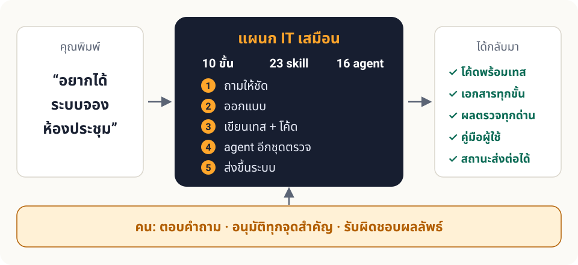
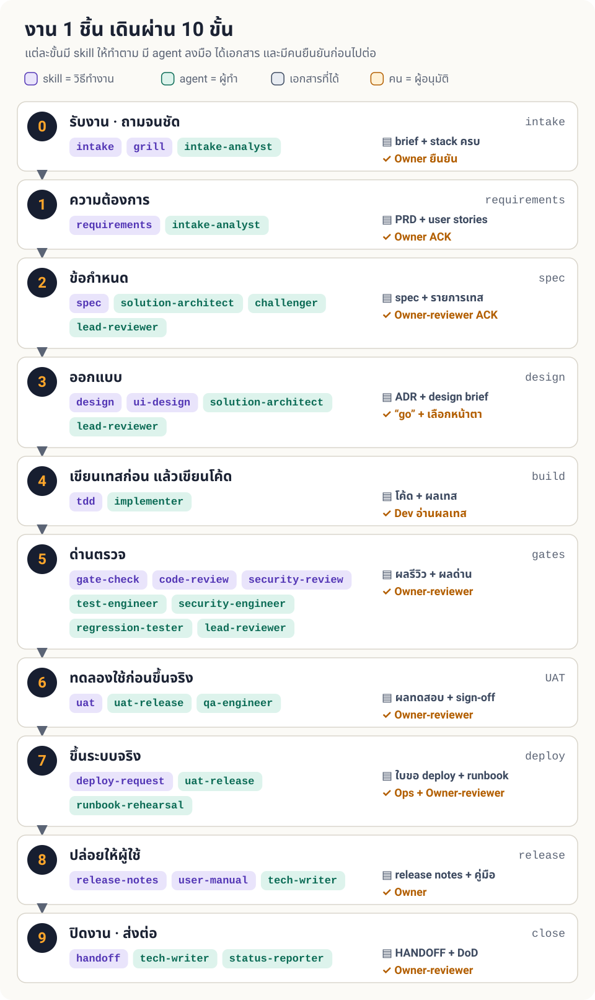
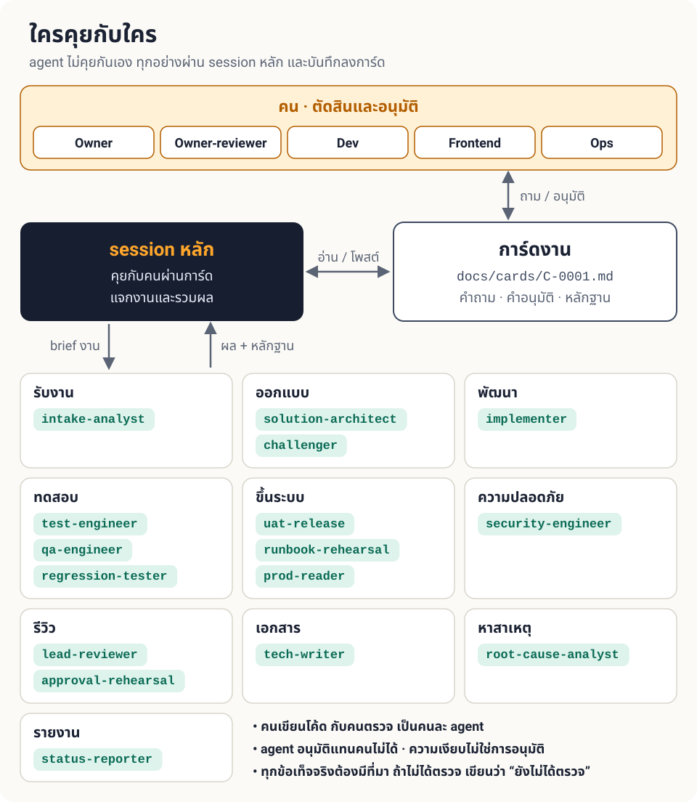
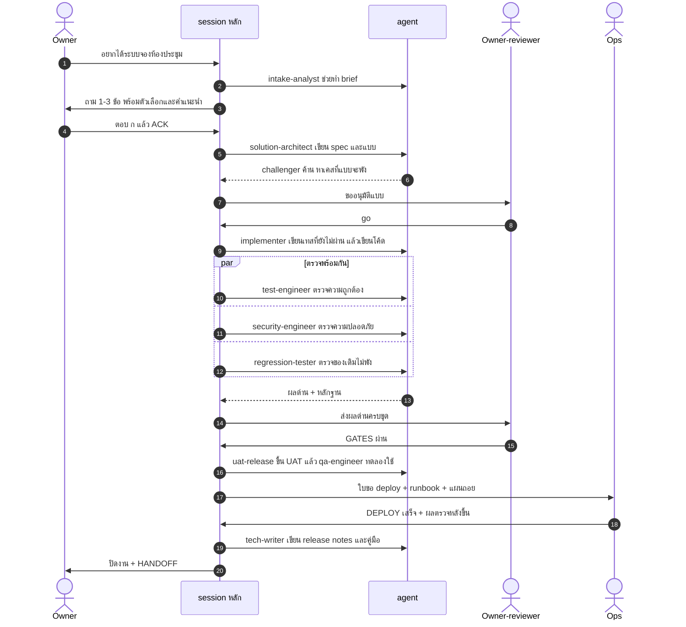
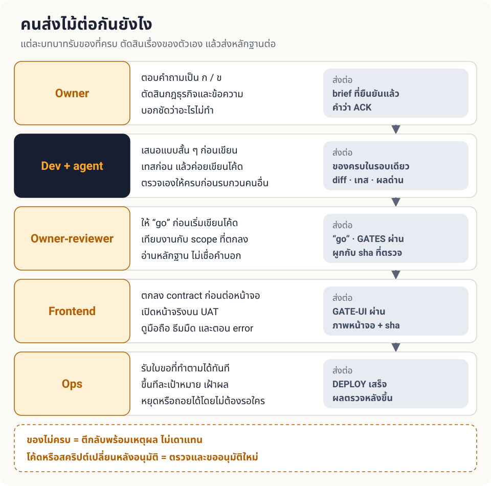
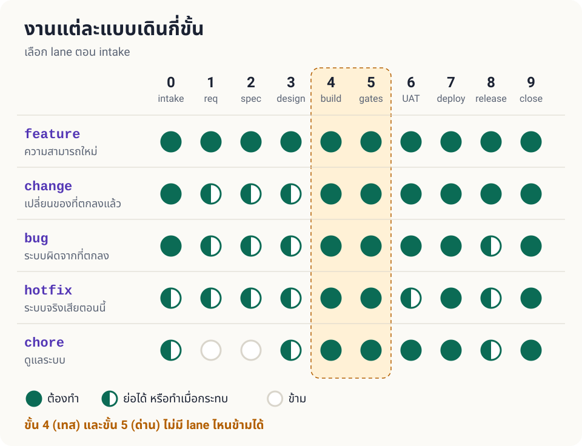
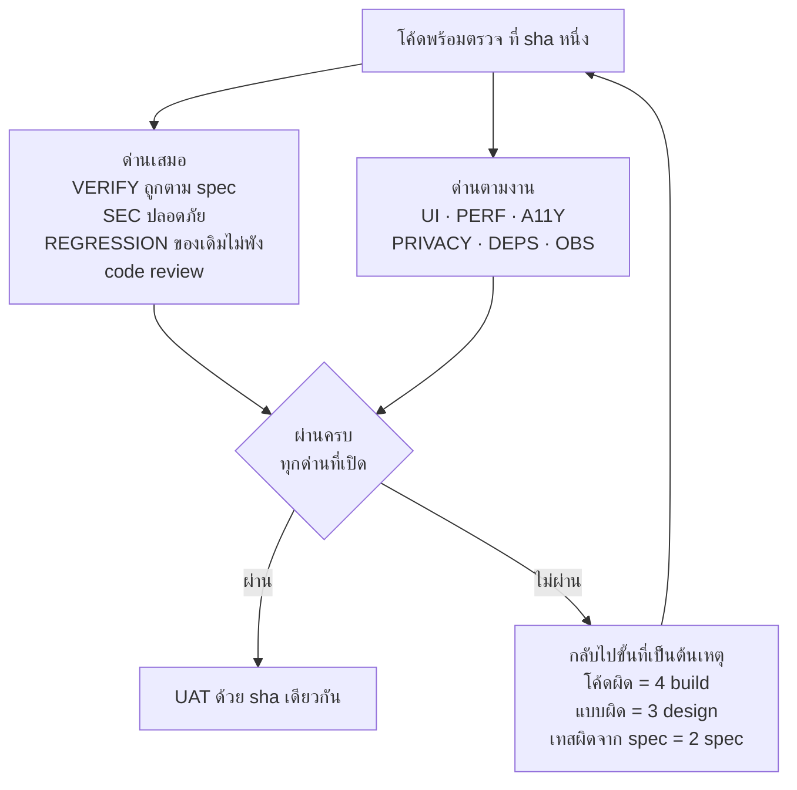

# engineering-blueprint

**ไทย** · [English](README.en.md)

**แม่แบบ repo ที่ทำให้ AI coding agent ทำงานเป็นขั้นตอนเหมือนแผนก IT แทนที่จะเขียนโค้ดตามคำสั่งทีละประโยค**
clone แล้วรันคำสั่งเดียว ได้ folder โปรเจกต์ใหม่ที่มีกติกา ขั้นตอน แม่แบบเอกสาร และบทบาท agent พร้อมใช้



> สถานะ: v0.3.0 · รุ่นแรก หลักการมาจากประสบการณ์ทำงานเป็นทีม แต่ repo ชุดนี้ยังไม่ผ่านการใช้งานจริงครบรอบ

**สารบัญ:** [ทำเพื่ออะไร](#ทำเพื่ออะไร) · [งานเดินยังไง](#งาน-1-ชิ้นเดินยังไง) · [agent ทำงานร่วมกันยังไง](#agent-ทำงานร่วมกันยังไง) · [หลักการทีม](#หลักการทำงานของทีม) · [ตัวอย่างทีละขั้น](#ตัวอย่าง-ระบบจองห้องประชุม) · [skill 21 ตัว](#skill-21-ตัว) · [agent 16 ตัว](#agent-16-ตัว) · [งานแต่ละแบบ](#งานแต่ละแบบ-5-lane) · [ด่าน](#ด่านตรวจ) · [เริ่มใช้](#เริ่มใช้)

## ทำเพื่ออะไร
AI เขียนโค้ดได้เร็ว แต่งานจริงมักพังเพราะเรื่องรอบ ๆ โค้ด:

| ปัญหา | ที่นี่จัดการยังไง |
|---|---|
| สั่งสั้น ๆ แล้ว AI เดา ได้ของไม่ตรง | skill `intake` ถามจนเข้าใจตรงกันก่อนเริ่ม |
| เปิดแชตใหม่แล้วลืมหมด | สถานะอยู่ใน `docs/HANDOFF.md` ความจำอยู่ใน `memory/` ไม่ได้อยู่ในแชต |
| โค้ดดูเสร็จแต่ไม่มีเทส | เขียนเทสจาก spec ก่อน แล้วให้อีก agent ตรวจแยก |
| token หรือรหัสผ่านหลุดเข้า git | hook สแกนก่อน commit |
| ไม่มีเอกสาร ส่งต่อไม่ได้ | แม่แบบตั้งแต่ requirement จนถึงคู่มือผู้ใช้ |
| ไม่รู้ว่าใครอนุมัติอะไร | คนอนุมัติบนการ์ด มีบทบาทและวันที่ |

ศัพท์ 4 คำที่ต้องรู้:
- **การ์ด** = งาน 1 ชิ้น เก็บคำถาม คำตอบ คำอนุมัติ และหลักฐาน (ค่าเริ่มต้นเป็นไฟล์ใน repo)
- **skill** = วิธีทำงานทีละขั้น เหมือนคู่มือปฏิบัติงาน
- **agent** = บทบาทที่ลงมือทำตาม skill เช่น คนออกแบบ คนเขียน คนตรวจ
- **ด่าน (gate)** = จุดตรวจที่ต้องผ่านก่อนไปต่อ

## งาน 1 ชิ้นเดินยังไง



ก่อนขั้น 0 มี `planning` จัดลำดับงาน · หลังขั้น 9 มี `retro` ทบทวนแล้วปรับวิธีทำงาน · ฉบับเต็ม [`docs/workflow.md`](docs/workflow.md)

## agent ทำงานร่วมกันยังไง



1. **คนคุยกับ session หลักที่เดียว** ไม่ต้องจำว่า agent ตัวไหนทำอะไร ต้องรู้แค่ว่าตัวเองต้องอนุมัติอะไร
2. **session หลักแจก brief** ให้ agent แต่ละตัว: อ่านไฟล์ไหน เขียนได้แค่ไฟล์ไหน เสร็จคืออะไร ห้ามอะไร
3. **agent ส่งผลพร้อมหลักฐานกลับ** เช่น `src/booking.ts:42@a1b2c3d` หรือ `npm test → "12 passed"`
4. **งานที่ไม่ชนไฟล์กันทำพร้อมกันได้** ไฟล์เดียวกันมีคนเขียนได้ทีละคน

เครื่องมือที่เรียก sub-agent ได้จะแยก agent ให้จริง เครื่องมือที่เรียกไม่ได้ ให้ session เดียวอ่านไฟล์บทบาทแล้วทำทีละบทบาท (แยกหน้าที่ได้อ่อนกว่า)

ลำดับการคุยกันของงาน 1 ชิ้น:



## หลักการทำงานของทีม
หลักการชุดนี้มาจากวิธีทำงานร่วมกันของคนหลายบทบาท เขียนใหม่ให้เป็นกลาง ใช้ได้กับทุกทีม



| หลักการ | ถ้าไม่ทำจะเจออะไร | ทำยังไงในนี้ |
|---|---|---|
| **ตกลงแบบก่อนเขียน** | เขียนเสร็จแล้วต้องรื้อ | design brief 5–8 บรรทัด → รีวิว → คำว่า "go" → ค่อยเขียน ([`design`](.claude/skills/design/SKILL.md)) |
| **ถามให้ตอบจบในรอบเดียว** | ถามตอบหลายวันไม่คืบ | คำถาม · ตัวเลือก · คำแนะนำ 1 ทาง · บอกว่าบล็อกอะไร ([`docs/posting.md`](docs/posting.md)) |
| **ทุกข้อเท็จจริงมีที่มา** | เถียงกันด้วยความจำ | อ้าง `file:line@sha` หรือคำสั่ง + บรรทัดผล ไม่ได้ตรวจก็เขียนว่า "ยังไม่ได้ตรวจ" |
| **ตรวจให้ครบก่อนส่งต่อ** | คนถัดไปเสียเวลารอและตีกลับ | Dev ไล่ checklist และให้ agent ซ้อมคำถามแทนผู้อนุมัติก่อน ([`docs/roles/dev.md`](docs/roles/dev.md)) |
| **คำอนุมัติผูกกับเวอร์ชัน** | อนุมัติอันหนึ่ง แต่ขึ้นอีกอัน | อนุมัติระบุ sha ไฟล์เปลี่ยน = ตรวจและขอใหม่ |
| **ความเงียบไม่ใช่การอนุมัติ** | งานเดินโดยไม่มีคนตัดสิน | ยังไม่ตอบ = ยังไม่ตัดสิน ระหว่างรอทำส่วนที่ไม่ติด |
| **Ops ได้ของที่ทำตามได้ทันที** | คนขึ้นระบบต้องเดาเอง | runbook ทีละบรรทัด ผลที่ควรเห็น จุดหยุด แผนถอย ([`docs/deploy.md`](docs/deploy.md)) |
| **ใช้สคริปต์ที่ตรวจแล้วแทนการกดมือ** | กดพลาด ทำซ้ำไม่ได้ | สคริปต์มีเทส มี dry-run อนุมัติผูกกับ hash ของไฟล์ ([`docs/db-scripts.md`](docs/db-scripts.md)) |
| **ตกลง contract ก่อนต่อหน้าจอ** | หน้าจอกับหลังบ้านไม่ตรงกัน | schema เดียวเป็นแหล่งจริง เทสทั้งสองฝั่ง ([`docs/roles/frontend.md`](docs/roles/frontend.md)) |
| **เสร็จ = ใช้ได้จริง** | "เสร็จแล้ว" แต่ยังไม่มีใครใช้ได้ | Definition of Done รวม UAT หน้าจริง เฝ้าหลังขึ้น และเอกสาร |
| **ด่านไม่ลด เร็วด้วยการทำขนาน** | รีบแล้วข้ามตรวจ พังบนของจริง | ตรวจหลายด่านพร้อมกัน โดนปฏิเสธ = หยุดถาม ไม่หาทางอ้อม |
| **ใครมาต่อก็ได้** | งานติดอยู่กับคนเดียว | `docs/HANDOFF.md` บอกว่าถึงไหน ใครรออะไร ทำอะไรต่อ |

## ตัวอย่าง: ระบบจองห้องประชุม
ตัวอย่างสมมติ ให้เห็นว่าคุณพิมพ์อะไรและได้อะไรกลับมา

| ขั้น | คุณทำ | เบื้องหลัง | ได้ไฟล์ |
|---|---|---|---|
| 0 intake | พิมพ์ "อยากได้ระบบจองห้องประชุม" แล้วตอบคำถาม | `intake-analyst` อ่าน repo ก่อน ถามทีละ 1–3 ข้อ เลือก lane และระดับเสี่ยง | `docs/requirements/0001-room-booking.md` |
| 1 requirements | อ่านแล้วตอบ ACK | แตกเป็น user story พร้อมเกณฑ์ผ่าน Given/When/Then | PRD + stories |
| 2 spec | Owner-reviewer ตอบ ACK | `solution-architect` เขียน `challenger` หาเคสพัง เช่น สองคนกดจองพร้อมกัน | `docs/specs/0001-room-booking.md` |
| 3 design | Owner-reviewer ตอบ "go" | เทียบทางเลือกอย่างน้อย 2 ทาง บันทึกเหตุผล | ADR + design brief |
| 4 build | รอ | `implementer` เขียนเทส "จองซ้อนต้องถูกปฏิเสธ" ให้ล้มก่อน แล้วเขียนโค้ดให้ผ่าน | โค้ด + เทส |
| 5 gates | Owner-reviewer อ่านผล | 4 agent ตรวจแยกกัน: ความถูกต้อง ความปลอดภัย ของเดิม รีวิวโค้ด | ผลด่านบนการ์ด |
| 6 UAT | Frontend ลองหน้าจริง | `uat-release` ขึ้น UAT `qa-engineer` ทดสอบตามเกณฑ์ | ผลทดสอบ + sign-off |
| 7 deploy | Ops อนุมัติและขึ้นระบบ | `runbook-rehearsal` เดิน runbook บนกระดาษหาช่องโหว่ก่อน | ใบขอ deploy + runbook |
| 8 release | Owner อ่านข้อความถึงผู้ใช้ | `tech-writer` เขียน | release notes + คู่มือเว็บ |
| 9 close | Owner-reviewer ปิดงาน | ตรวจ Definition of Done | `docs/HANDOFF.md` |

หน้าตาการ์ด (ไฟล์ `docs/cards/C-0001.md` รูปแบบตามที่ได้จากการรันคำสั่งในโปรเจกต์ทดลอง):

```markdown
# C-0001 · ระบบจองห้องประชุม

- lane: feature
- R: R2
- status: intake
- created: 2026-11-22

---
### 2026-11-22T05:32:24.939Z · agent

รับ C-0001 · ขั้น 0 intake

คำถาม 1/3: จองซ้อนเวลาเดียวกันได้ไหม
- ก) ไม่ได้ ระบบปฏิเสธทันที (แนะนำ: ป้องกันสองทีมมาชนกัน)
- ข) ได้ แต่ต้องมีผู้อนุมัติ
บล็อก: ออกแบบการจอง

---
### 2026-11-22T05:32:25.075Z · owner

ก) ไม่ได้
```

## skill 21 ตัว
skill คือไฟล์ markdown ใน [`.claude/skills/`](.claude/skills/) อ่านได้ด้วยเครื่องมือทุกตัว

| ช่วง | skill | ใช้เมื่อ |
|---|---|---|
| **ก่อนเริ่ม** | `planning` | จัดลำดับ backlog และขนาดงาน |
| | `intake` | มีคำขอใหม่ ถามจนชัด |
| | `change-request` | ขอเปลี่ยนสิ่งที่ตกลงแล้ว |
| **คิด** | `requirements` | แปลง brief เป็น PRD และ user story |
| | `spec` | เขียนข้อกำหนดพร้อมผลที่ถูกและรายการเทส |
| | `design` | เทียบทางเลือก บันทึกเหตุผล ขอ "go" |
| **ทำ** | `tdd` | เทสก่อนโค้ด |
| | `bugfix` | ทำซ้ำอาการ หาต้นเหตุ แก้น้อยที่สุด |
| | `hotfix` | ระบบจริงเสียตอนนี้ |
| | `db-script` | สคริปต์อ่าน/แก้ข้อมูลอย่างปลอดภัย |
| **ตรวจ** | `gate-check` | ไล่ทุกด่านของงาน |
| | `code-review` | รีวิวโค้ดก่อน merge |
| | `security-review` | ตรวจตาม OWASP ASVS และ Top 10 |
| | `uat` | ขึ้น UAT และทดสอบการใช้งานจริง |
| **ส่งมอบ** | `deploy-request` | ใบขอ deploy ที่ Ops ทำตามได้ทันที |
| | `release-notes` | CHANGELOG และเลขเวอร์ชัน |
| | `user-manual` | คู่มือผู้ใช้แบบเว็บ |
| **สื่อสารและเรียนรู้** | `post` | โพสต์บนการ์ดให้ตอบจบในรอบเดียว |
| | `handoff` | บันทึกสถานะให้คนถัดไป |
| | `postmortem` | ทบทวนเหตุโดยไม่โทษคน |
| | `retro` | ทบทวนรอบงานแล้วปรับวิธีทำงาน |

## agent 16 ตัว
ไฟล์บทบาทอยู่ใน [`.claude/agents/`](.claude/agents/) · ระดับ model ตั้งตามความยากของงาน · ทุกตัวอนุมัติแทนคนไม่ได้

| ฝ่าย | agent | ทำอะไร | model | มีเครื่องมือเขียนไฟล์ |
|---|---|---|---|---|
| รับงาน | `intake-analyst` | ทำคำขอเป็น brief เสนอ lane และระดับเสี่ยง | เล็ก | – |
| ออกแบบ | `solution-architect` | spec · ทางเลือก · ADR | แรงสุด | ✓ เอกสาร |
| | `challenger` | หาเคสที่ทำให้แบบพัง | แรงสุด | – |
| พัฒนา | `implementer` | เทสก่อน แล้วเขียนโค้ด | กลาง | ✓ โค้ด |
| ทดสอบ | `test-engineer` | เขียนเทสจาก spec แยกจากคนเขียนโค้ด | กลาง | ✓ เทส |
| | `qa-engineer` | ทดลองใช้บน UAT · UI · ความเร็ว · การเข้าถึง | กลาง | – |
| | `regression-tester` | ของเดิมยังใช้ได้ไหม ถอยได้ไหม | แรงสุด | – |
| ความปลอดภัย | `security-engineer` | OWASP · ข้อมูลส่วนบุคคล · dependency | แรงสุด | – |
| ขึ้นระบบ | `uat-release` | ขึ้น UAT เตรียมใบขอ ไม่แตะ production | กลาง | – |
| | `runbook-rehearsal` | ซ้อม runbook บนกระดาษ | แรงสุด | – |
| | `prod-reader` | รันสคริปต์อ่านที่อนุมัติแล้วเท่านั้น | เล็ก | – |
| เอกสาร | `tech-writer` | HANDOFF · CHANGELOG · คู่มือ | เล็ก | ✓ เอกสาร |
| รีวิว | `lead-reviewer` | รีวิวโค้ด เทียบกับ scope | แรงสุด | – |
| | `approval-rehearsal` | ซ้อมคำถามที่ผู้อนุมัติจะถาม | แรงสุด | – |
| หาสาเหตุ | `root-cause-analyst` | หาต้นเหตุจากหลักฐาน ไม่แก้โค้ด | กลาง | – |
| รายงาน | `status-reporter` | สรุปสถานะให้คนนอกทีมอ่านเข้าใจ | เล็ก | ✓ รายงาน |

ช่อง "–" คือไม่ได้ให้เครื่องมือ Write/Edit แต่ตัวที่มี Bash ยังเขียนไฟล์ได้ในทางเทคนิค จึงเป็นคำสั่งห้าม ไม่ใช่กลไกกันทั้งหมด

## งานแต่ละแบบ (5 lane)



ระดับความเสี่ยงเพิ่มความเข้ม ไม่ใช่ลดด่าน:

| | R1 ต่ำ | R2 กลาง | R3 สูง |
|---|---|---|---|
| ตัวอย่าง | ข้อความ สไตล์ เอกสาร | ฟีเจอร์ใหม่ทั่วไป | สิทธิ์ · ข้อมูลส่วนบุคคล · ข้อมูลที่ย้อนไม่ได้ |
| ขั้น 1–3 | ข้ามได้ ใช้ brief | spec และแบบต้องมี | ต้องครบ |
| ความปลอดภัย | checklist พื้นฐาน | ASVS L1 | ASVS L2 |
| รีวิว | AI 1 | AI + คน 1 | AI + คนที่ไม่ใช่ผู้เขียน |
| ขึ้นระบบ | ปกติ | ทีละเป้าหมาย + เฝ้า | + สวิตช์ปิด + ซ้อมแผนถอย |

## ด่านตรวจ



โค้ดเปลี่ยน = sha ใหม่ = ตรวจใหม่ · เกณฑ์และผู้อนุมัติแต่ละด่าน [`docs/gates.md`](docs/gates.md)

### อะไรบังคับจริง อะไรเป็นแนวทาง
| บังคับด้วยโค้ด | เป็นคำสั่งให้ agent และ checklist ให้คน |
|---|---|
| สแกนค่าลับ IP และคำต้องห้ามตอน commit | ลำดับ 10 ขั้น และด่านทั้งหมด |
| รูปแบบ commit message | การแยกหน้าที่และการอนุมัติ |
| ตรวจร่างโพสต์ก่อนส่งขึ้นบอร์ด | เนื้อหาเอกสารตามแม่แบบ |

ผลจริงเมื่อโดนบล็อก:

```text
$ node scripts/board.mjs post C-0001 .scratch/bad.md      # ร่างเขียนว่า "ถ้าไม่ตอบจะทำต่อ"
FAIL draft-check .scratch/bad.md
- ความเงียบไม่ใช่การอนุมัติ — ระบุคำถามและรอคำตอบ (AGENTS.md §7)

$ git commit -m "update stuff"
FAIL commit-msg: "update stuff"
ต้องเป็น <type>(<scope>)?: <ข้อความ ≤ 100 ตัว>
```

ตัวสแกนช่วยลดความเสี่ยง ไม่ได้จับได้ทุกอย่าง และ repo นี้ไม่ใช่ใบรับรองมาตรฐานใด ๆ

## เริ่มใช้
ต้องมี Node.js 20+ · git · AI coding agent ที่อ่าน `AGENTS.md` ได้ (เช่น Claude Code, Codex)
```bash
git clone https://github.com/6amdev/engineering-blueprint.git
cd engineering-blueprint
node scripts/new-project.mjs ../my-project    # สร้างโปรเจกต์ใหม่ (ไม่ push ไม่สร้าง remote)
cd ../my-project
npm install                                   # เปิด git hooks
node scripts/board.mjs new C-0001 "งานแรก"    # การ์ดแรก เป็นไฟล์ใน docs/cards/
```

เปิด folder ด้วย agent แล้วพิมพ์:

| อยากทำอะไร | พิมพ์ว่า |
|---|---|
| เริ่มงานใหม่ | `เริ่มการ์ด C-0001 ด้วย skill intake` |
| แจ้งบั๊ก | `กดบันทึกแล้วหน้าค้าง ใช้ skill bugfix` |
| ขอเปลี่ยน | `ขอให้จองล่วงหน้าได้ 30 วัน ใช้ skill change-request` |
| ระบบจริงเสีย | `ล็อกอินไม่ได้ทั้งระบบ ใช้ skill hotfix` |
| ตรวจความปลอดภัย | `ตรวจการ์ด C-0001 ด้วย skill security-review` |
| ถามสถานะ | `สรุปการ์ดที่ค้างให้ status-reporter เขียน` |
| เลิกงานวันนี้ | `ปิดรอบด้วย skill handoff` |

จะใช้ทั้งองค์กรอ่าน [`docs/onboarding.md`](docs/onboarding.md) · บอร์ดงาน: ค่าเริ่มต้นเป็นไฟล์ใน repo ไม่ต้องสมัครอะไร ต่อ Trello หรือ GitHub Issues ได้ (สองแบบหลังยังไม่ได้ทดสอบส่งจริง)

### ใช้กี่คน
| ทีม | แบ่งบทบาท |
|---|---|
| 1 คน | ถือทุกบทบาท agent ช่วยตรวจ งาน R3 ให้หาคนที่สอง ถ้าไม่มีจริงบันทึกการรับความเสี่ยงบนการ์ด (อ่อนกว่าการมีคนที่สอง) |
| 2–3 คน | คนเขียนไม่ใช่คนให้ "go" และไม่ใช่คนอนุมัติ deploy ของงาน R3 |
| 5–10 คน | แยกครบ มีสำรองฝั่ง Owner-reviewer และ Ops |

## เหมาะ / ไม่เหมาะ
- **เหมาะ:** ทีมเล็กหรือคนเดียวที่ใช้ AI ทำงานส่วนใหญ่ · องค์กรที่อยากให้พนักงานสร้างระบบภายในอย่างมีขั้นตอน · งานที่ต้องส่งต่อ
- **ไม่เหมาะ:** สคริปต์ใช้ครั้งเดียว · ทีมที่มีกระบวนการครบอยู่แล้ว · คนที่อยากให้ AI ทำทั้งหมดโดยไม่มีคนอนุมัติ
- **ใช้กับงานที่ถูกต้องเท่านั้น:** intake ถามเรื่องสิทธิ์ในระบบ ข้อมูล และเนื้อหาก่อนเริ่ม งานที่ผิดกฎหมายหรือไม่มีสิทธิ์ = ไม่รับ

## โครง repo
```
AGENTS.md          กติกากลางที่ agent ทุกตัวอ่าน
docs/              workflow · ด่าน · มาตรฐาน · บทบาท · deploy · การ์ด · ADR
templates/         แม่แบบเอกสาร
.claude/skills/    ขั้นตอนทำงาน (markdown ธรรมดา)
.claude/agents/    บทบาท agent
scripts/           สร้างโปรเจกต์ · บอร์ด · ตัวสแกน · ภาพใน README
site/              ตัวอย่างคู่มือผู้ใช้ (VitePress)
memory/            ความจำของ agent (ไม่ขึ้น git)
```

## ข้อจำกัดที่รู้
- ยังไม่มีคำสั่งอัปเกรดโปรเจกต์ที่สร้างไปแล้ว
- hook ใช้กับเครื่องที่รัน `npm install` แล้วเท่านั้น
- ตัวเลขเริ่มต้นในเอกสาร (เช่นงบ performance) เป็นจุดตั้งต้น ให้ทีมปรับเอง
- เอกสารใน `docs/` เป็นภาษาไทย

ร่วมพัฒนา: [`CONTRIBUTING.md`](CONTRIBUTING.md) · แจ้งช่องโหว่: [`SECURITY.md`](SECURITY.md)

## License
[Apache-2.0](LICENSE) · Copyright 2026 6amdev
ใช้ แก้ไข แจกต่อ และใช้ในงานบริษัทได้ฟรี โดยทำตามเงื่อนไขใน `LICENSE` (เช่น คงข้อความลิขสิทธิ์ และระบุไฟล์ที่แก้) · โปรเจกต์ที่สร้างด้วย `new-project` ได้สำเนาชื่อ `LICENSE-blueprint` ซึ่งครอบเฉพาะไฟล์ที่มาจาก blueprint โค้ดของโปรเจกต์เลือก license เองได้
