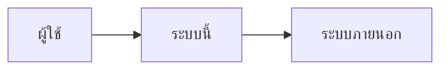
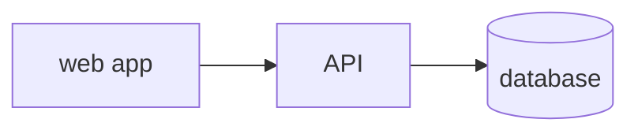

# Design brief: <ชื่อเรื่อง>

> ขั้น 3 · สั้น 5–8 บรรทัดต่อหัวข้อ · ภาพใช้ C4 (context + container) · ห้ามใส่ค่าลับ / IP / ข้อมูลส่วนบุคคล (PII)

## ส่วนหัว
| ช่อง | ค่า |
|---|---|
| id | `docs/specs/NNNN-slug-design.md` · card `C-0001` |
| สถานะ | ร่าง / รอ review / "go" แล้ว |
| วันที่ | YYYY-MM-DD |
| ผู้เขียน (role) | solution-architect |
| ผู้ยืนยัน (role) | Owner-reviewer (พูดว่า "go") |
| เอกสารขั้นก่อน | spec: `SP-NNNN` <ลิงก์> |
| ระดับ R | R1/R2/R3 |

## สรุป 5–8 บรรทัด
<!-- ทำอะไร · เปลี่ยนตรงไหน · ไม่แตะอะไร · เสี่ยงอะไร · ถอยอย่างไร -->
1. <...>

## C4 ระดับ 1: context
<!-- ใครใช้ · ระบบนี้ · ระบบภายนอกที่คุยด้วย; วาดเป็น mermaid -->

## C4 ระดับ 2: container
<!-- แอป · API · DB · queue · งานเบื้องหลัง และเส้นทางข้อมูล -->

## ส่วนที่เปลี่ยน
| ส่วน | เปลี่ยนอะไร | ไฟล์ / โมดูล |
|---|---|---|
| <...> | <...> | <path> |

## data flow + สิทธิ์ + ความปลอดภัย
- ข้อมูลไหลจาก <...> ไป <...> · ที่ไหนมี PII: <...>
- authn/authz: <...> · trust boundary: <...> · secret เก็บที่: <ที่เก็บ ไม่ใช่ค่า>

## ทางเลือก + ADR
- การตัดสินใจที่มีผลระยะยาวลง ADR: <ADR-NNNN> · ทางที่ไม่เลือก: <...>

## เทส + สังเกตการณ์ + ถอย
- เทส: <ชี้รายการเทสใน spec · T-NNNN-NN>
- log/metric/alert ที่เพิ่ม: <...> (GATE-OBS ถ้าขึ้น prod)
- migration / flag / วิธีถอย: <...>

## ตรวจก่อนขอ "go"
- [ ] ตรงกับ spec ทุก FR · ไม่เพิ่มของนอก scope
- [ ] มีภาพ context + container
- [ ] ระบุ trust boundary + PII
- [ ] มีวิธีถอยที่ทดสอบได้
- [ ] lead-reviewer รีวิวแบบแล้ว · ข้อค้านจาก challenger ปิดครบ (R2/R3)
